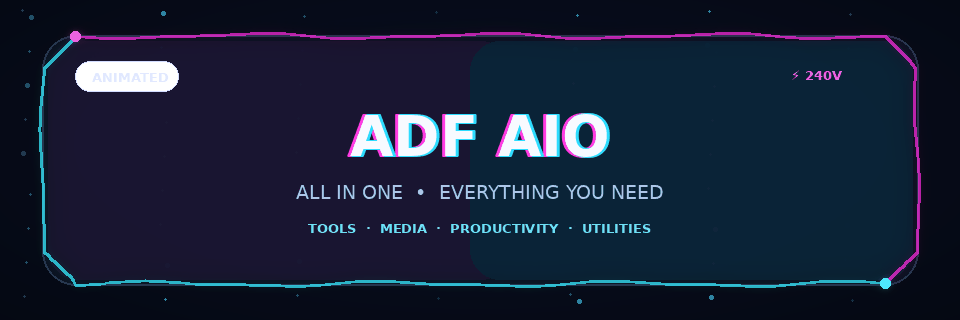

<div align="center">



**NOONE CAN USE MY SOURCE CODE WITHOUT MY PERMS, YOU CAN USE THE APP PROVIDED BUT YOU HAVE NO RIGHTS TO MAKE YOUR OWN APP USING MY SOURCE CODE..**

# ADF AIO

### All in One. Everything You Need.

A modern all-in-one application bringing useful tools, social platforms, productivity features, creative resources, and utilities together in one place.

[Explore the project](https://ishantkohli.me/Media/media.html)

</div>

---

## ✨ About

**ADF AIO** is designed to make everyday digital tasks easier by bringing useful resources into a unified, easy-to-navigate experience. Its visual identity combines a dark interface, electric cyan and violet accents, and polished interactive elements.

## 🚀 Highlights

- **Social & Media Hub** — convenient access to Instagram, GitHub, LinkedIn, X/Twitter, YouTube, WhatsApp, Facebook, and Reddit.
- **All-in-one experience** — a central place for tools, utilities, and resources.
- **Modern visual design** — dark styling, gradients, neon accents, and glass-inspired components.
- **Motion-focused UI** — subtle transitions and animated details designed to make interactions feel responsive.
- **Built to evolve** — a project that can grow with new tools and improvements.

> Feature availability depends on the current implementation and integrations.

## 🖥️ Preview

The animated banner above is part of this README and is rendered from `assets/adf-aio-banner.gif`.

## 🔧 Getting Started

Clone this repository:

```bash
git clone YOUR_REPOSITORY_URL
cd YOUR_PROJECT_FOLDER
```

Then follow the setup instructions for the framework and dependencies used by your project. Check the project's configuration files for the appropriate installation and development commands.

## 🧭 Project Status

ADF AIO is under active development. Features, design, and integrations may change as the project evolves.

## 🤝 Contributions

Suggestions and bug reports are welcome. Open an issue to discuss a significant change before submitting a pull request.

## 🔐 Security

Do not commit API keys, passwords, access tokens, private configuration files, or other secrets. Use environment variables for sensitive configuration where applicable.


**NOONE CAN USE MY SOURCE CODE WITHOUT MY PERMS, YOU CAN USE THE APP PROVIDED BUT YOU HAVE NO RIGHTS TO MAKE YOUR OWN APP USING MY SOURCE CODE..**


---

<div align="center">

**ADF AIO — All in One, For You.**

</div>
